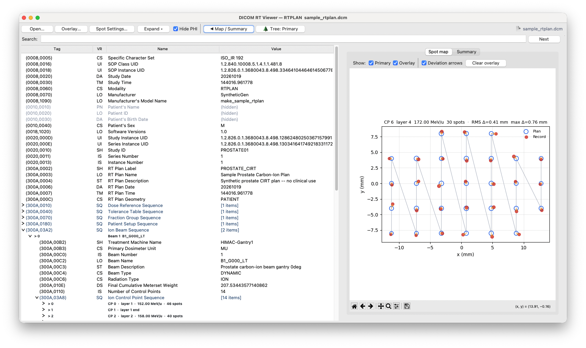

# DICOM RT Viewer

**RT Record · RT Plan · RT Dose** DICOM 파일을 위한 경량 데스크탑 뷰어입니다.
Python과 tkinter로 구현되었으며, 단일 파일로 실행됩니다.

원래 탄소이온 치료 RT Record(조사 로그) 리뷰 목적으로 개발되었으며,
현재는 RT 전용 DICOM 전체를 지원하는 범용 인스펙터로 확장되었습니다.



---

## 주요 기능

### 공통
- 태그 트리 브라우저 (Sequence 클릭으로 펼침/접기)
- Modality별 요약 정보 (Summary 탭)
- PHI 가리기 토글 (환자 이름 · ID · 생년월일 마스킹)
- 태그 이름 / 번호 / 값으로 검색 — 검색창 옆에 결과 건수 표시
- **Expand ▾ / Collapse ▴** 토글 버튼 — 한 번 누르면 트리 전체 펼침, 다시 누르면 접힘
- 우측 패널(Map / Summary)은 **기본적으로 숨김** — **Map / Summary ▶** 버튼으로 펼침; Control Point 클릭 시 자동으로 열림
- **📄 파일 표시** (툴바 우측) — 커서를 올리면 primary · overlay 파일명이 위아래로 표시됨; `▶`는 현재 트리에 표시 중인 파일을 나타냄

### RT Record · RT Plan — Spot Map
- 에너지 레이어(Control Point)별 스팟 조사 경로 시각화
- MU 가중치에 비례한 스팟 크기; 첫 번째 / 마지막 스팟 강조 표시
- Fixed-coordinate 스팟 자동 감지 및 표시
- **호버 툴팁**: 커서를 스팟 위에 올리면 해당 스팟의 좌표와 MU 값을 표시
- **스크롤 휠**: 스팟 맵 위에서 스크롤하면 이전/다음 에너지 레이어로 이동
- **Plan vs Record 오버레이**: 두 번째 파일(RT Plan 또는 RT Record)을 로드해 같은 축에 스팟 위치 비교
  - Plan 스팟: 파란 빈 원 · Record 스팟: 빨간 채운 원
  - **Deviation arrows**: Plan → Record 방향 화살표; 제목에 RMS Δ, 최대 Δ 표시. 두 파일 간 실제 위치 차이가 있을 때만 표시됨.
  - **보이기/숨기기 토글**: Primary 스팟과 Overlay 스팟을 각각 독립적으로 on/off
  - **🌲 Tree: Primary / Overlay** 버튼 (툴바) — 태그 트리를 오버레이 파일로 전환; 다시 누르면 복귀. 오버레이 로드 시에만 활성화됨.
- **Spot Settings…**: 전용 다이얼로그에서 스팟 표시 설정:
  - 단일 파일: 스팟 색상, 경로선 색상
  - First / Last 스팟: 보이기/숨기기 + 범례 레이블 텍스트 + 색상
  - 오버레이: Plan · Record 레이블 + 색상, 편차 화살표 색상
- 키보드 화살표로 레이어 이동

### RT Dose — Dose Map
- Axial / Coronal / Sagittal 슬라이스 뷰어
- 슬라이스 슬라이더 및 현재 인덱스 표시
- **스크롤 휠**: 선량 맵 위에서 스크롤하면 이전/다음 슬라이스로 이동
- **W/L (Window/Level) 슬라이더**: Min / Max 표시 범위를 Gy 단위로 독립 조절
- Reset 버튼으로 전체 범위 복원

### 내보내기
- 현재 그림을 PNG / PDF / SVG로 저장

### 키보드 단축키
| 키 | 동작 |
|----|------|
| `Ctrl+O` | 파일 열기 |
| `Ctrl+Shift+O` | 오버레이 파일 열기 |
| `Ctrl+S` | 그림 저장 |
| `← →` 또는 `↑ ↓` | RT Dose: 이전/다음 슬라이스 · RT Plan/Record: 이전/다음 에너지 레이어 |

---

## 요구 사항

```
python >= 3.8
pydicom
numpy
matplotlib
tkinter  # python.org 공식 빌드에 기본 포함
```

의존성 설치:

```bash
pip install pydicom numpy matplotlib
```

> **macOS (Homebrew Python)**: tkinter가 포함되지 않습니다. 별도 설치 필요:
> ```bash
> brew install python-tk
> ```

---

## 실행 방법

```bash
# GUI에서 파일 선택
python dicom_rt_viewer.py

# 파일 직접 지정
python dicom_rt_viewer.py path/to/file.dcm
```

### 기본 사용 흐름

1. **Open…** 버튼 (또는 `Ctrl+O`)으로 `.dcm` 파일을 선택합니다.
2. 왼쪽 태그 트리에서 Sequence 항목(`> 0`, `> 1`, …)을 클릭해 펼치거나, **Expand ▾** 버튼으로 전체를 한 번에 펼칩니다.
3. **Control Point** 항목(RT Plan / RT Record)을 클릭하면 우측 패널이 자동으로 열리며 스팟 맵이 표시됩니다.
4. RT Dose는 로드 시 자동으로 **Dose Map** 탭이 열립니다. 방향 콤보박스와 슬라이더로 슬라이스를 탐색합니다.

### Plan vs Record 오버레이

1. RT Plan **또는** RT Record 중 하나를 기본 파일로 엽니다.
2. **Overlay…** 버튼 (또는 `Ctrl+Shift+O`)으로 보완 파일을 선택합니다.
3. 임의의 Control Point로 이동하면 두 스팟 패턴이 같은 축에 표시됩니다.
4. **Primary** / **Overlay** 체크박스로 각 스팟 세트를 독립적으로 보이거나 숨깁니다.
5. **Deviation arrows** 체크박스로 Plan → Record 방향 화살표를 표시합니다.
6. 툴바의 **🌲 Tree: Primary** 버튼을 눌러 태그 트리를 오버레이 파일로 전환하고, **🌲 Tree: Overlay**를 누르면 복귀합니다.
7. **Clear overlay**로 오버레이를 제거합니다.

### Spot Settings

**Spot Settings…** 버튼을 클릭하면 설정 다이얼로그가 열립니다:

| 섹션 | 설정 항목 |
|------|---------|
| Single file | 스팟 색상, 경로선 색상 |
| First spot | 보이기/숨기기, 범례 레이블 텍스트, 색상 |
| Last spot | 보이기/숨기기, 범례 레이블 텍스트, 색상 |
| Overlay | Plan · Record 레이블 + 색상, 편차 화살표 색상 |

First/Last 체크박스를 해제하면 해당 마커가 그려지지 않습니다. 레이블 텍스트를 비우면 legend에서 해당 항목이 제거됩니다.

### W/L 조절 (RT Dose)

- **Min** 슬라이더: 표시 하한을 높여 저선량 배경을 억제합니다.
- **Max** 슬라이더: 표시 상한을 낮춰 저선량 영역의 대비를 강조합니다.
- **Reset**: `[0, max_dose]`로 복원합니다.

---

## 파일 구조

```
dicom_rt_viewer.py  # 메인 애플리케이션 (단일 파일, pip 의존성 외 없음)
README.md           # 영문 설명서
README_KO.md        # 한국어 설명서 (이 파일)
requirements.txt
LICENSE
```

---

## 지원 DICOM SOP Class

| SOP Class UID | Modality |
|---------------|----------|
| 1.2.840.10008.5.1.4.1.1.481.2 | RT Dose |
| 1.2.840.10008.5.1.4.1.1.481.5 | RT Plan |
| 1.2.840.10008.5.1.4.1.1.481.8 | RT Ion Plan |
| 1.2.840.10008.5.1.4.1.1.481.9 | RT Ion Beams Treatment Record |
| 1.2.840.10008.5.1.4.1.1.481.4 | RT Beams Treatment Record |

---

## 라이선스

MIT
